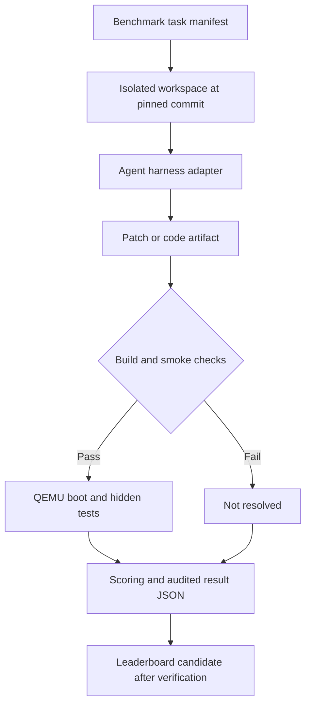

<div align="center">

# ⚡ BIOSBench
### Can Your AI Agent Boot a Machine — or Just Write Code?

**A benchmark framework for AI Coding Agents & Harnesses in real-world BIOS / UEFI firmware engineering.**

*From source patch → firmware build → virtual boot → observable behavior.*

     

**Agent-agnostic · Harness-aware · Firmware-first · Reproducibility-oriented**

[Vision](#-the-challenge) · [Tracks](#-two-firmware-tracks) · [Scoring](#-evaluation-protocol-proposed) · [Architecture](#-architecture) · [Roadmap](#-roadmap) · [Related Work](#-related-projects)

</div>

> [!IMPORTANT]
> **PREVIEW / SCAFFOLD ONLY.** This repository currently contains **zero validated benchmark tasks**, **no working firmware runner**, and **no measured leaderboard results**. The tracks, interfaces, scoring policy and commands below are *design proposals*, not completed capabilities. Please do not quote this as a published benchmark result.

## 🔥 The Challenge

**A passing unit test is not a successful boot. A compilable patch is not a working firmware fix.**

Modern coding agents can write C. But can an entire **Harness + Agent + Model** stack navigate a firmware tree, debug initialization, repair UEFI protocols, compile a bootable image, and produce the expected behavior under an emulator?

**BIOSBench** aims to measure *end-to-end firmware engineering*, not just plausible code generation. It is designed to compare Claude Code, Codex, OpenCode, DeepSeek-based harnesses and custom tool-using agents under the **same task, workspace, budget and validation policy**.

### What it intends to measure

| Dimension | Example evidence | Proposed scoring |
|---|---|---|
| Codebase navigation & diagnosis | Correct bug localization | Diagnostic only |
| Source changes | Patch applies cleanly | Gate |
| Buildability | EDK II/coreboot build | Gate |
| Boot behavior | QEMU boots to target checkpoint | Gate / optional task test |
| Functional correctness | Hidden behavioral tests | **Primary** |
| Regression safety | Previously passing tests stay green | Required |
| Agent efficiency | Wall time, tokens, tool calls, cost | Secondary |

> **Not** a benchmark of proprietary vendor BIOS, silicon bring-up, real flash operations or hardware coverage. Emulator evidence cannot certify a production device.

## 🧱 Two Firmware Tracks

### Track A — UEFI Engineering: EDK II + OVMF + QEMU

Planned tasks: DXE drivers, boot services, UEFI variables, protocols, boot-manager logic, firmware bug fixes. The future runner will pin EDK II at an exact commit, compile OVMF where supported, start a sandboxed QEMU guest, and check machine-readable boot/test evidence.

**Upstream:** [TianoCore EDK II](https://github.com/tianocore/edk2) · [EDK II Test](https://github.com/tianocore/edk2-test) · [QEMU](https://www.qemu.org/)

### Track B — Boot Firmware: coreboot + QEMU

Planned tasks: boot configuration, early-boot code, platform initialization and emulator-supported fault fixes. Hardware-specific issues must be excluded unless a reproducible emulator fixture exists.

**Upstream:** [coreboot](https://github.com/coreboot/coreboot) · [coreboot QEMU documentation](https://doc.coreboot.org/mainboard/emulation/qemu-i440fx.html)

## ⚙️ Architecture



Everything beyond the manifest schema is **planned**; no operational pipeline exists yet.

## 🧪 Evaluation Protocol (proposed)

**Primary metric:** `Resolved@1 = validated tasks solved / total validated tasks`, using a fixed agent budget and an independently held-out test set. All failed runs count in the denominator. No partial credit for an unbootable image when booting is a necessary task condition.

**Additional reports:** `Pass@k` (with a stated sampling policy), median wall-clock duration, total tokens, tool calls, estimated API cost and infrastructure failures. Publish separate scores for Track A and Track B. Record the model, harness version, prompting/instructions, tool permissions, context settings, container image digest and upstream commit SHA.

**Anti-contamination:** reserve hidden tests; avoid publishing unreleased gold patches; record task provenance and chronological cutoff. Hidden tests must never be present in an agent-visible filesystem.

**Safety:** QEMU only, snapshot/ephemeral disks, no host firmware flashing, no network by default, resource limits and process timeouts.

## 📦 Repository Layout

```text
BIOSBench/
├── benchmarks/
│   ├── edk2-ovmf/          # planned task manifests
│   └── coreboot/           # planned task manifests
├── adapters/               # planned harness integrations
├── runner/                 # planned sandbox, build, QEMU verification
├── schemas/task.schema.json
├── docs/
│   ├── DESIGN.md           # scope and evidence requirements
│   ├── ROADMAP.md
│   └── CONTRIBUTING_TASKS.md
├── examples/               # synthetic template, NOT scored
└── README.md
```

## 🚀 Quick Start (scaffold inspection only)

```bash
# Download or clone this scaffold when published
# Inspect the example task structure; this DOES NOT run a firmware benchmark.
python3 -m json.tool examples/task-template.json
```

**Coming later (not executable today):** `biosbench run --agent opencode --track edk2-ovmf --tasks all`. This is an illustrative planned command, not a working CLI.

## 🏆 Leaderboard

| Harness | Model | EDK II resolved | coreboot resolved | Verification |
|---|---|---:|---:|---|
| *No submissions yet* | — | — | — | Not launched |

We will not publish invented performance numbers. Results can appear only after the evaluation protocol and tasks are released and verified.

## 🗺️ Roadmap

- [x] Public benchmark vision and proposed schema
- [ ] 5 independently validated EDK II + OVMF tasks
- [ ] 5 independently validated coreboot + QEMU tasks
- [ ] Reproducible containerized toolchains with immutable digests
- [ ] Patch collection and agent adapters (OpenCode / Codex / Claude Code / custom)
- [ ] Build + boot + hidden-tests grader
- [ ] Repeat-run score aggregation and reviewed leaderboard
- [ ] Public v0.1 methodology and validation report

## 🔗 Related Projects

BIOSBench is a **new proposed benchmark framework**. It does not claim to be affiliated with or to reproduce the work of:

- [EDK II](https://github.com/tianocore/edk2) — UEFI firmware development.
- [EDK II Test](https://github.com/tianocore/edk2-test) — firmware test resources.
- [coreboot](https://github.com/coreboot/coreboot) — open-source boot firmware.
- [QEMU](https://www.qemu.org/) — system emulation for future reproducible checks.
- [LLM Firmware Benchmark](https://github.com/arjun7965/llm-firmware-benchmark) — general firmware/embedded code benchmark and agent execution framework; **not a BIOS-specific question set**.
- [HWE-bench](https://github.com/pku-liang/hwe-bench) — hardware engineering benchmark whose real-repo bug-fix evaluation style inspires this design.

## 📜 License & Attribution

Scaffold documentation and metadata: [Apache-2.0](LICENSE). Upstream code, images, tests and datasets remain under their **own licenses**. This repository intentionally does **not** vendor or redistribute EDK II, coreboot or QEMU. External dependencies and corresponding notices must be reviewed before integration.

---

<div align="center"><strong>Don't just generate firmware. Prove it boots.</strong><br><sub>BIOSBench · Preview scaffold · Not yet an executable benchmark</sub></div>
